# BIZORA — MASTER ARCHITECTURAL DIAGRAMS SPECIFICATION

**Document Reference:** BIZORA-ARCH-DIAGRAMS-V1.0  
**Status:** DRAFT FOR STAKEHOLDER REVIEW  
**Lifecycle Phase:** Phase 03 System Architecture  
**Author:** Principal Software Architect  
**Date:** 2026-11-21  

---

## 1. SYSTEM CONTEXT DIAGRAM

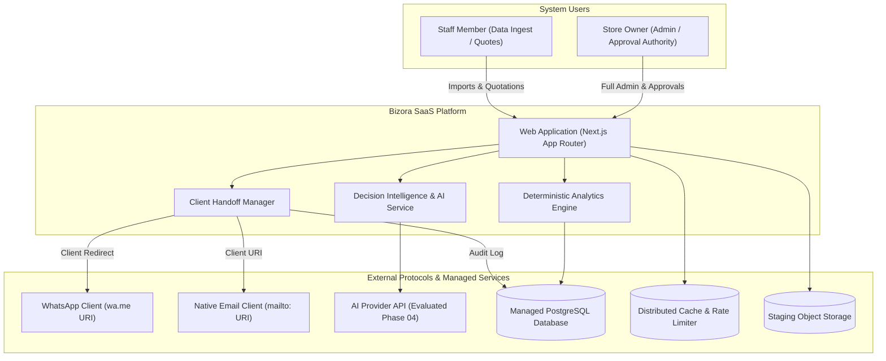

---

## 2. HIGH-LEVEL CONTAINER ARCHITECTURE

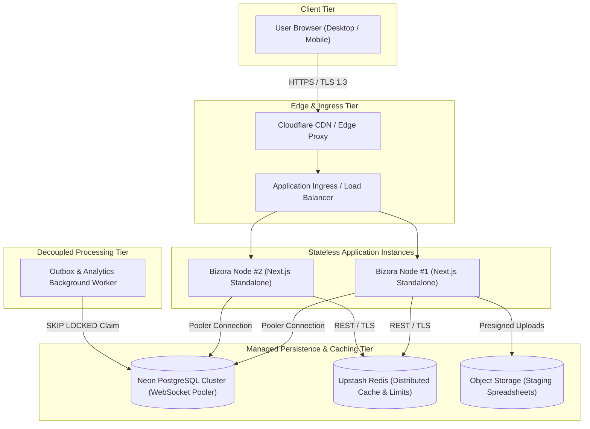

---

## 3. APPLICATION MODULE ARCHITECTURE

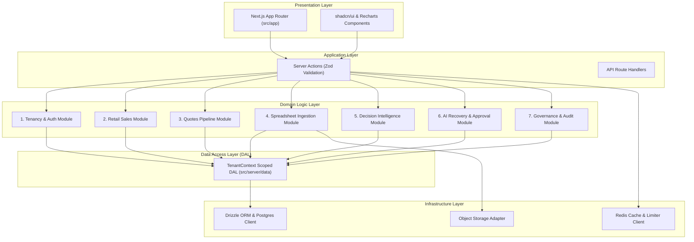

---

## 4. TENANT ISOLATION AND AUTHORIZATION FLOW

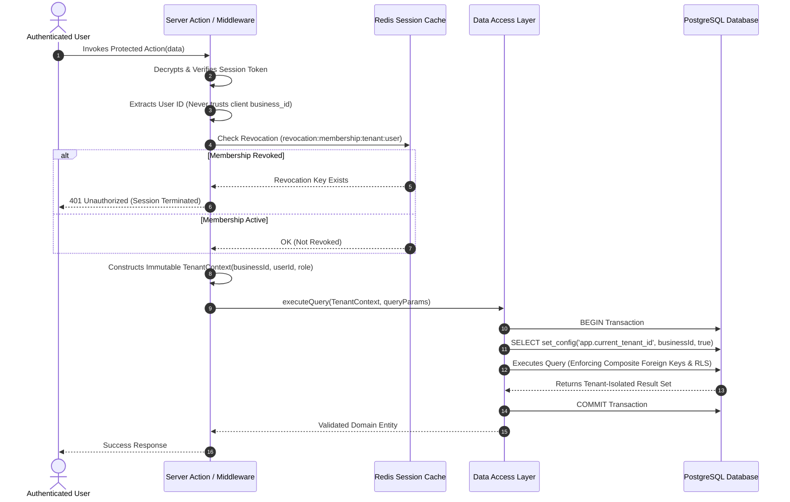

---

## 5. SPREADSHEET INGESTION PROCESSING SEQUENCE

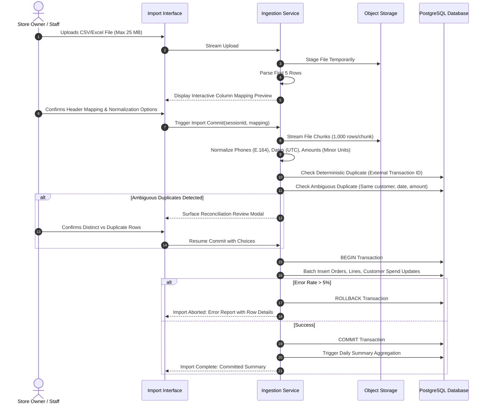

---

## 6. AI RECOMMENDATION AND APPROVAL SEQUENCE

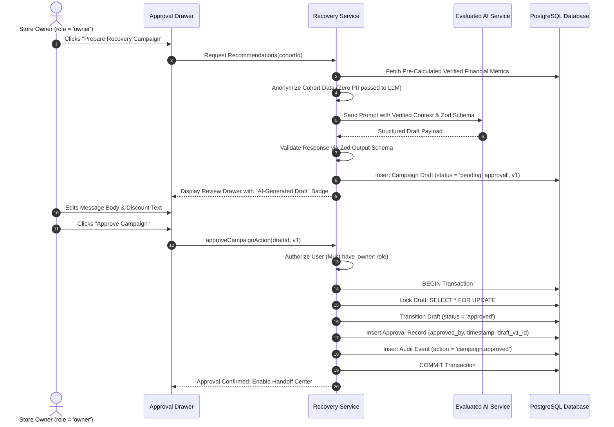

---

## 7. COMMUNICATION HANDOFF SEQUENCE

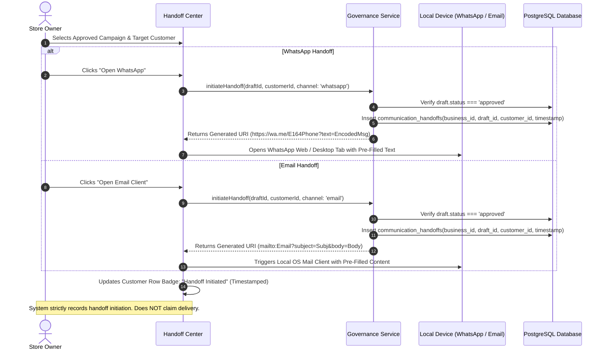

---

## 8. FINANCIAL DATA FLOW

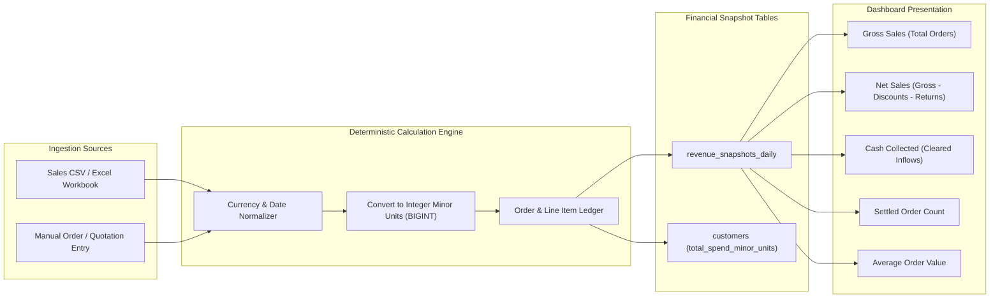

---

## 9. BACKGROUND PROCESSING FLOW

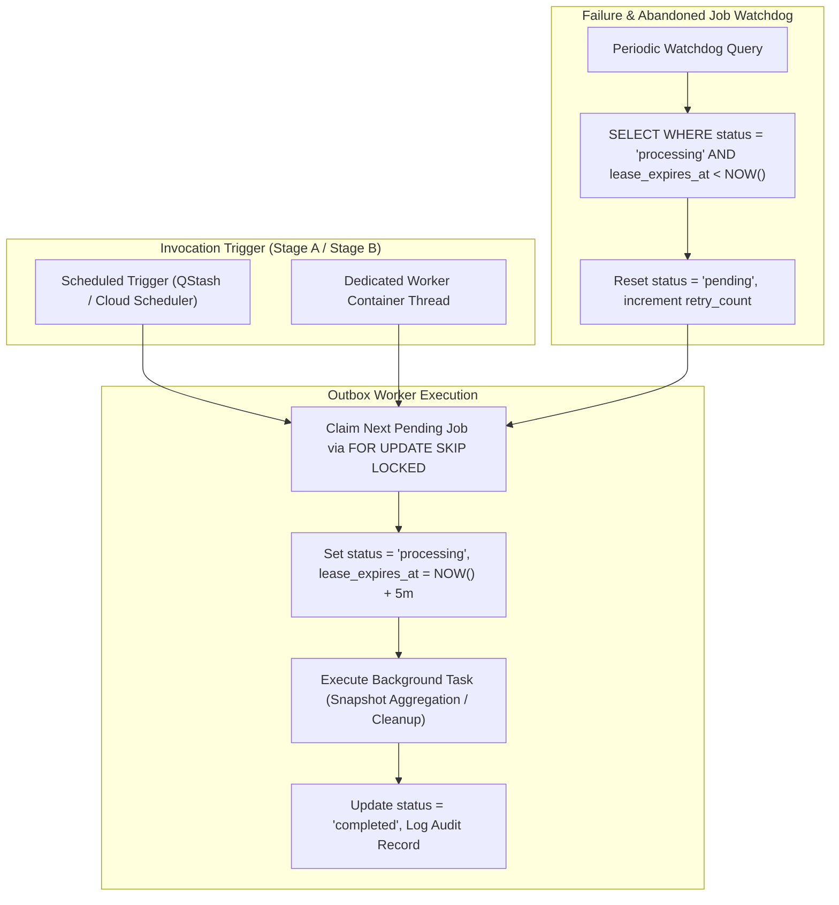

---

## 10. DEPLOYMENT ARCHITECTURE (HYBRID STAGES)

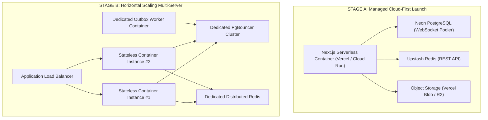

---

## 11. FAILURE AND RECOVERY FLOW

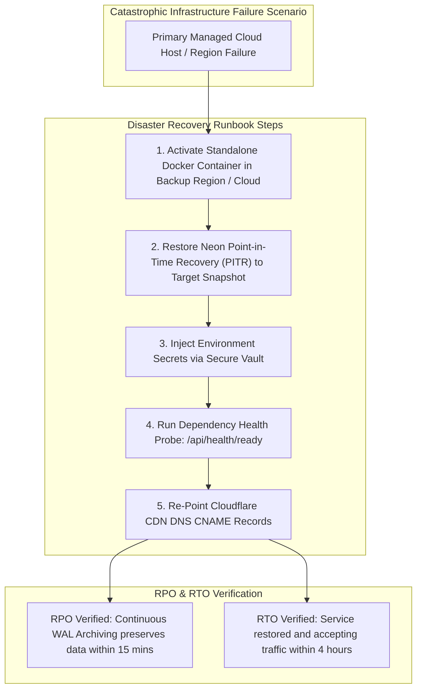
