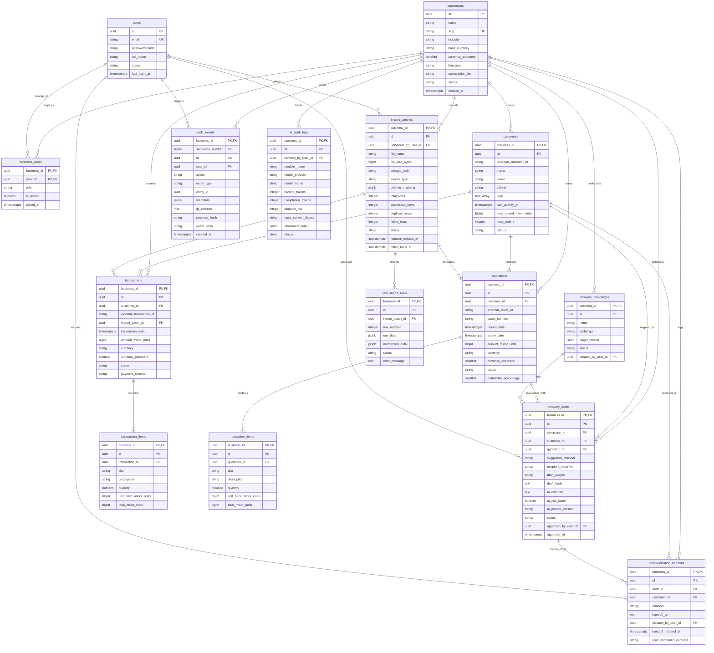

# BIZORA — ENTITY-RELATIONSHIP DIAGRAM (ERD)

**Document Version:** 1.0.0  
**Status:** Approved Architectural Specification  
**Date:** 2026-11-21  
**Project:** Bizora ("Move Your Business Forward")  
**Engine:** Mermaid ERD Specification  

---

## 1. Visual Entity-Relationship Diagram

---

## 2. Key Relational Integrity Notes

1. **Composite Primary Keys:** All business-specific tables (`customers`, `transactions`, `quotations`, `import_batches`, `recovery_drafts`, `communication_handoffs`) enforce `PRIMARY KEY (business_id, id)`.
2. **Tenant-Safe Foreign Keys:** Child tables reference parent tables using compound foreign keys: `FOREIGN KEY (business_id, parent_id) REFERENCES parent(business_id, id)`. This makes accidental cross-tenant linkages structurally impossible.
3. **Audit Immutability:** `audit_events` utilizes `PRIMARY KEY (business_id, sequence_number)` with a strict monotonic counter per business, preventing gap insertion or out-of-order event injection.
